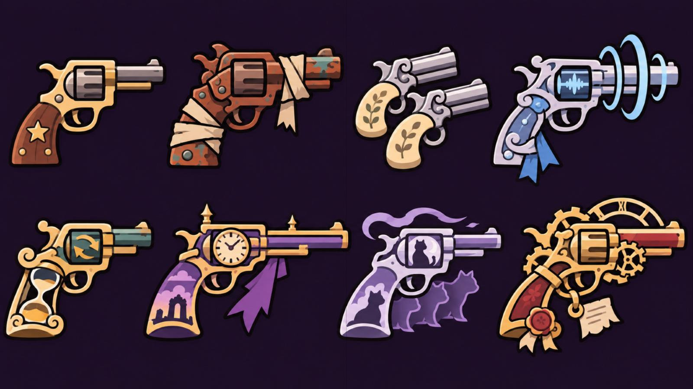
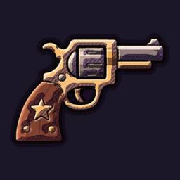
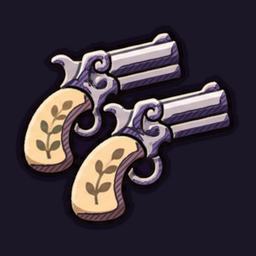
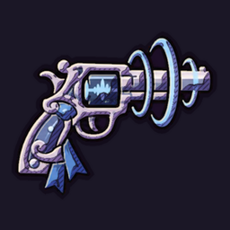
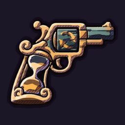
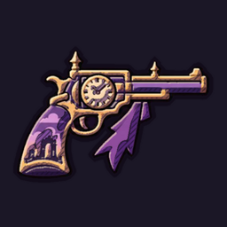
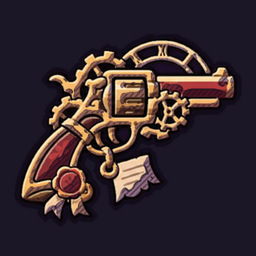

# Cat_Tang 총 기획서

- 작성: 정승운 · 2026-11-14 · 상태: 초안
- 표기: **[확정]** = 사용자가 정한 것 · **[1차안]** = 수치 · 목록 1차본 (플레이 테스트로 조정)
- 데이터: `docs/data/Cat_Tang_Data.xlsx` (관리) · `Game/Assets/Data/Tables/*.csv` (게임) · 생성 스크립트 `docs/tools/build_tables.py`

---
## 1. 개요 [확정]
- 총도 드랍 아이템. 아무 손에나 장착 (오른손 = 홀수 칸, 왼손 = 짝수 칸 담당).
- 총마다 다른 것: **기본 수치 · 고유 효과 · 스킬 1개** (스컬의 머리처럼). 양손 합쳐 스킬 2개.
- **고유 효과 적용 범위 [확정]:** 그 총이 담당하는 칸의 탄에만 (오른손 = 홀수 칸, 왼손 = 짝수 칸). 스킬 · 완벽 장전처럼 탄과 무관한 효과만 전역 (`[전역]` 표시).
- 총에는 연산 슬롯이 없다 (연산은 탄에).
- 등급 4단계 (일반 · 희귀 · 영웅 · 전설). 높을수록 고유 효과가 복잡.
- 교체는 전투 밖에서만.

## 2. 기본 수치 [1차안]
| 열 | 뜻 |
|---|---|
| DamageMul | 탄 공격력 배율 |
| FireInterval | 발사 간격 (초) |
| ReloadTime | 장전 시간 (초) |
| Range | 사거리 (m) |

## 3. 스킬 [확정: 쿨타임 방식]
| Id | 스킬 | 쿨타임 | 내용 |
|---|---|---|---|
| 6001 | 백스텝 샷 | 6.0초 | 조준 반대쪽으로 4m 도약하며 2발 |
| 6002 | 앞뒤 네 발 | 7.0초 | 앞을 2발 쏘고 홱 돌아 뒤로 2발 |
| 6003 | 넘어가며 쏘기 | 8.0초 | 적을 뛰어넘으며 아래로 3발, 쏠 때마다 반동으로 더 뜸 |
| 6004 | 반사탄 패링 | 6.0초 | 0.3초 안에 적 투사체를 쏘면 피해 150%로 되돌려 보냄 |
| 6005 | 모래 장판 | 12.0초 | 반경 4 모래 장판, 적 둔화 40%, 4초 |
| 6006 | 조준 사격 | 10.0초 | 모아서 모든 적을 관통하는 1발 (피해 400%) |
| 6007 | 회상의 실루엣 | 15.0초 | 고양이 실루엣을 불러 4초 동안 함께 사격 (피해 60%) |
| 6008 | 시간 정지 | 25.0초 | 반경 8 적의 시간을 2초 동안 멈춤 |

## 4. 총 목록 (8종) [1차안]

|  | Id | 이름 | 등급 | 공격력 | 발사 간격 | 장전 | 사거리 | 스킬 | 고유 효과 |
|---|---|---|---|---|---|---|---|---|---|
|  | 2001 | **보안관의 리볼버** | 일반 | ×1.0 | 0.3초 | 1.2초 | 12.0m | 백스텝 샷 | 없음 |
|  | 2002 | **녹슨 콜트** | 일반 | ×1.3 | 0.42초 | 1.4초 | 12.0m | 앞뒤 네 발 | [상시] 판정 시각이 짝수인 탄 피해 +20% |
|  | 2003 | **쌍둥이 데린저** | 희귀 | ×0.75 | 0.18초 | 1.0초 | 9.0m | 넘어가며 쏘기 | [상시] 판정 시각 6 이하 탄 연사 +15% |
|  | 2004 | **은빛 메아리** | 희귀 | ×1.0 | 0.3초 | 1.2초 | 12.0m | 반사탄 패링 | [튕김] 이 총의 탄이 튕길 때마다 피해 +10% |
|  | 2005 | **백투더 퓨처** | 희귀 | ×1.0 | 0.32초 | 1.3초 | 11.0m | 모래 장판 | [상시] 판정 시각이 음수인 탄 피해 +30% |
|  | 2006 | **지평선** | 영웅 | ×1.8 | 0.65초 | 1.8초 | 18.0m | 조준 사격 | [상시] 판정 시각 12 초과 탄 피해 +35% / [명중] 이 총의 탄은 멀리 있는 적일수록 피해 증가 (1m당 +2%, 최대 +40%) |
|  | 2007 | **동경** | 영웅 | ×1.1 | 0.28초 | 1.2초 | 12.0m | 회상의 실루엣 | [발사] 이 총의 탄을 쏠 때 10% 확률로 실루엣이 1발 더 (피해 50%) / [스킬] [전역] 스킬을 쓰면 열기 +0.5칸 |
|  | 2008 | **마지막 종소리** | 전설 | ×1.2 | 0.3초 | 1.0초 | 13.0m | 시간 정지 | [상시] 12시 칸 탄 피해 +50% / [완벽 장전] [전역] 완벽 장전 때 반경 6 적 0.5초 정지 |

## 5. 데이터 테이블

### Gun

| 열 | 타입 |
|---|---|
| Id | int |
| Name | string |
| Grade | enum |
| DamageMul | float |
| FireInterval | float |
| ReloadTime | float |
| Range | float |
| SkillId | int |
| Effect1 | int |
| Effect2 | int |
| IconKey | string |
| Desc | string |

### Skill

| 열 | 타입 |
|---|---|
| Id | int |
| Name | string |
| Action | enum |
| Cooldown | float |
| Value | float |
| Value2 | float |
| Duration | float |
| Desc | string |

## 6. 정해야 할 것
- [ ] 수치 조정 (플레이 테스트)
- [ ] 아이콘 · 3D 모델
- [ ] 총 드랍 위치
