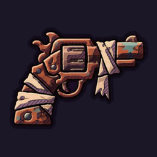
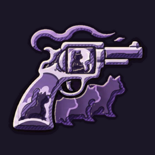

# Cat_Tang 총 기획서

- 작성: 정승운 · 2026-11-14 · 상태: 초안
- 표기: **[확정]** = 사용자가 정한 것 · **[1차안]** = 수치 · 목록 1차본 (플레이 테스트로 조정)
- 데이터: `docs/data/Cat_Tang_Data.xlsx` (관리) · `Game/Assets/Data/Tables/*.csv` (게임) · 생성 스크립트 `docs/tools/build_tables.py`

---
## 1. 개요 [확정]
- 총도 드랍 아이템. 아무 손에나 장착 (오른손 = 홀수 칸, 왼손 = 짝수 칸 담당).
- 총마다 다른 것: **기본 수치 · 고유 효과 · 스킬 1개** (스컬의 머리처럼). 양손 합쳐 스킬 2개.
- **손별 효과 [확정]:** 같은 총도 오른손 효과와 왼손 효과가 다르다 (오른손 = 공격, 왼손 = 보조 쪽). 기본 총(보안관의 리볼버)은 양손 모두 효과 없음.
- **효과 적용 범위 [확정]:** 그 손이 담당하는 칸의 탄에만 (오른손 = 홀수 칸, 왼손 = 짝수 칸). 스킬 · 장전 끝처럼 탄과 무관한 효과만 전역 (`[전역]` 표시).
- **양손 2자루만 [확정]:** 보관함에 넣거나 팔 수 없다. 주우면 교체 창에서 왼손에 쥐기 · 오른손에 쥐기 · 버리기. 빠진 총 · 버린 총은 바닥에 떨어져 다시 주울 수 있다. 시작은 양손 기본 총.
- 총에는 연산 슬롯이 없다 (연산은 탄에).
- 등급 4단계 (일반 · 희귀 · 영웅 · 전설). 높을수록 고유 효과가 복잡.
- 교체는 전투 밖에서만.

## 2. 기본 수치 [1차안]
| 열 | 뜻 |
|---|---|
| DamageMul | 탄 공격력 배율 |
| FireInterval | 발사 간격 (초) — 모든 총 0.3초로 통일 (2026-11-18), 총 개성은 사거리로 |
| ReloadTime | 장전 시간 (초) |
| Range | 사거리 (m) — 이보다 먼 적은 안 맞음. 조준 커서가 사거리 밖이면 흐려지고 사거리 끝에 빨간 점 |

## 3. 스킬 [확정: 쿨타임 방식]
| Id | 스킬 | 쿨타임 | 내용 |
|---|---|---|---|
| 6001 | 백스텝 샷 | 6.0초 | 조준 반대쪽으로 4m 도약하며 2발 |
| 6002 | 앞뒤 네 발 | 7.0초 | 앞을 2발 쏘고 홱 돌아 뒤로 2발 |
| 6003 | 넘어가며 쏘기 | 8.0초 | 적을 뛰어넘으며 아래로 3발, 쏠 때마다 반동으로 더 뜸 |
| 6004 | 반사탄 패링 | 6.0초 | 0.3초 안에 적 투사체를 쏘면 피해 150%로 되돌려 보냄 |
| 6005 | 모래 장판 | 12.0초 | 반경 4 모래 장판, 적 둔화 40%, 4초 |
| 6006 | 조준 사격 | 10.0초 | 모아서 모든 적을 관통하는 1발 (피해 400%) |
| 6007 | 회상의 실루엣 | 15.0초 | 고양이 실루엣을 불러 4초 동안 함께 사격 (피해 60%) |
| 6008 | 시간 정지 | 25.0초 | 반경 8 적의 시간을 2초 동안 멈춤 |

## 4. 총 목록 (8종) [1차안]

|  | Id | 이름 | 등급 | 공격력 | 사거리 | 장전 | 스킬 | 고유 효과 |
|---|---|---|---|---|---|---|---|---|
|  | 2001 | **보안관의 리볼버** | 일반 | ×1.0 | 12m | 1.2초 | 백스텝 샷 | 없음 |
|  | 2002 | **녹슨 콜트** | 일반 | ×1.25 | 9m | 1.4초 | 앞뒤 네 발 | 오른손: [상시] 판정 시각이 짝수인 탄 피해 +20% 왼손: [명중] 이 총의 탄에 맞은 적을 크게 밀쳐냄 |
|  | 2003 | **쌍둥이 데린저** | 희귀 | ×1.3 | 7m | 1.0초 | 넘어가며 쏘기 | 오른손: [상시] 판정 시각 6 이하 탄 연사 +15% 왼손: [상시] [전역] 대시 충전 시간 -20% |
|  | 2004 | **은빛 메아리** | 희귀 | ×1.0 | 12m | 1.2초 | 반사탄 패링 | 오른손: [관통] 이 총의 탄이 적을 꿰뚫을 때마다 그 자리에 은빛 메아리 폭발 (피해 40%, 반경 1.5) 왼손: [명중] 이 총의 탄이 적 1명 관통 |
|  | 2005 | **백투더 퓨처** | 희귀 | ×1.0 | 12m | 1.3초 | 모래 장판 | 오른손: [상시] 판정 시각이 음수인 탄 피해 +30% 왼손: [장전] [전역] 장전할 때마다 사격 순서를 뒤집음 (1→12 ↔ 12→1) |
|  | 2006 | **지평선** | 영웅 | ×1.0 | 20m | 1.8초 | 조준 사격 | 오른손: [상시] 판정 시각 12 초과 탄 피해 +35% / [명중] 이 총의 탄은 멀리 있는 적일수록 피해 증가 (1m당 +2%, 최대 +40%) 왼손: [명중] 이 총의 탄이 적 1명 관통 |
|  | 2007 | **동경** | 영웅 | ×1.15 | 13m | 1.2초 | 회상의 실루엣 | 오른손: [발사] 이 총의 탄을 쏠 때 10% 확률로 실루엣이 1발 더 (피해 50%) 왼손: [스킬] [전역] 스킬을 쓰면 열기 +0.5칸 |
|  | 2008 | **마지막 종소리** | 전설 | ×1.2 | 15m | 1.0초 | 시간 정지 | 오른손: [명중] 이 총의 탄이 10% 확률로 적을 1초 시간에 가둠 / [상시] 이 총의 탄이 가장 가까운 적을 따라감 왼손: [장전 끝] [전역] 장전이 끝날 때 반경 6 적 0.5초 정지 |

## 5. 데이터 테이블

### Gun

| 열 | 타입 |
|---|---|
| Id | int |
| Name | string |
| Grade | enum |
| DamageMul | float |
| FireInterval | float |
| ReloadTime | float |
| Range | float |
| SkillId | int |
| RightEffect1 | int |
| RightEffect2 | int |
| LeftEffect1 | int |
| LeftEffect2 | int |
| IconKey | string |
| Desc | string |
| CritChance | float |
| CritDamage | float |

### Skill

| 열 | 타입 |
|---|---|
| Id | int |
| Name | string |
| Action | enum |
| Cooldown | float |
| Value | float |
| Value2 | float |
| Duration | float |
| Desc | string |

## 6. 정해야 할 것
- [ ] 수치 조정 (플레이 테스트)
- [ ] 아이콘 · 3D 모델
- [ ] 총 드랍 위치
