# Cat_Tang 총탄 기획서

- 작성: 정승운 · 2026-11-14 · 상태: 초안
- 표기: **[확정]** = 사용자가 정한 것 · **[1차안]** = 수치 · 목록 1차본 (플레이 테스트로 조정)
- 데이터: `docs/data/Cat_Tang_Data.xlsx` (관리) · `Game/Assets/Data/Tables/*.csv` (게임) · 생성 스크립트 `docs/tools/build_tables.py`

---
## 1. 개요 [확정]
- 탄 = 아이템, 실린더 12칸 = 인벤토리. 놓는 자리가 곧 빌드.
- 탄 하나 = **자리 조건 1개 + 특성 2개 + 고유 효과 + 공격력 + 연산 슬롯 0~2칸.**
- 판정 시각(놓인 시각에 연산 적용)이 자리 조건에 맞으면 **깨어남.**
  - 깨어난 탄: 특성 + 고유 효과 + 공격력
  - 못 깨어난 탄: 공격력만
- **적용 범위**
  - 탄 고유 효과 [확정]: 깨어나 있으면 **모든 사격에 적용** (발사 · 명중 · 처치 · 장전 · 상시). 같은 효과는 깨어난 탄 수만큼 겹친다.
  - **그 탄을 직접 쏠 때는 강화**: 효과가 한 번 더 걸리고(확률 · 위력 2배) **공명 사격**(굵은 두 겹 궤적 · 금빛 섬광 · 맞은 자리 탄 색 폭발 피해 30% · 화면 흔들림)이 나간다.
  - 특성: 단계는 **깨어난 탄**의 특성으로 세고, 켜진 효과는 **모든 탄**(깨어나지 못한 탄 포함)에 적용.
  - 총 고유 효과: 그 총이 담당하는 칸(오른손 홀수 · 왼손 짝수)의 탄에만. 스킬 · 완벽 장전처럼 탄과 무관한 효과만 전역 (총 기획서).
- 이름은 시간과 관련된 몽환적 · 시적 표현. "~탄"으로 통일하지 않고, 등급이 높을수록 고유한 이름.
- 아이콘도 같은 방향: 꿈속 같은 시적 분위기, 탄마다 색 · 재질 · 실루엣이 확실히 다름.
## 2. 등급 [확정]
| 등급 | 탄 수 | 고유 효과 | 드랍 가중치 [1차안] | 색 |
|---|---|---|---|---|
| 일반 | 16 | 1개 | 60 | #9AA0A6 |
| 희귀 | 13 | 1개 | 28 | #4F8CE0 |
| 영웅 | 10 | 최대 2개 | 10 | #9B5DE5 |
| 전설 | 8 | 최대 2개 | 2 | #E0A63A |

- 등급이 높을수록 고유 효과가 복잡해진다 (세피리아 · 스컬 아이템 방식).
  - 일반: 단순한 한 줄 효과
  - 희귀: 조건이 붙은 효과
  - 영웅: 다른 칸 · 다른 시스템과 엮이는 효과
  - 전설: 규칙을 바꾸는 효과
- 연산 슬롯 수는 등급과 무관. 효과가 강한 탄은 슬롯이 적을 수 있다.

## 3. 자리 조건 [확정]
| CondType | 뜻 |
|---|---|
| Odd | 판정 시각이 홀수 |
| Even | 짝수 |
| MultipleOf | CondValue의 배수 (0 · 음수 포함) |
| Prime | 소수 (2 · 3 · 5 · 7 · 11 · 13 …) |
| Negative | 음수 |
| Zero | 0시 |
| Exact | CondValue와 같음 |
| GreaterThan | CondValue 초과 |
| LessThan | CondValue 미만 |
| None | 조건 없음 (깨어나지 않는 기본 탄) |

- 판정 규칙(12 초과 · 0 이하 값 유지, 반올림, 0시 만능 등)은 컨셉 기획서 8.2.

## 4. 특성 (9종) [확정 · 수치는 1차안]
- 같은 특성의 깨어난 탄이 2 · 4 · 6개면 단계 상승. 2 · 4는 수치, 6은 새 효과.

| 특성 | 느낌 | 2개 | 4개 | 6개 (새 효과) |
|---|---|---|---|---|
| 회상 | 고양이 실루엣이 나타나 함께 쏜다 | 탄을 쏠 때 10% 확률로 고양이 실루엣이 같은 방향으로 1발 (피해 50%) | 실루엣 확률 20% | 실루엣이 3초 동안 남아 내 사격을 따라 함 |
| 추억 | 같은 적을 계속 맞히면 추억 표식이 새겨진다 | 맞힐 때마다 추억 표식, 표식당 그 적에게 피해 +3% (최대 10개) | 표식당 +5% | 표식 10개인 적을 맞히면 표식을 터뜨려 피해 300% |
| 망각 | 적을 시간 속에 가둬 멈추고 더 아프게 한다 | 8% 확률로 시간 속에 가둠: 1초 정지, 받는 피해 +30% | 확률 15% | 갇힌 적이 풀릴 때 시간 파편 폭발 (피해 100%, 반경 3) |
| 되감기 | 피해를 맞기 직전의 순간으로 되감는다 (회피) | 피해를 8% 확률로 회피 (잠깐 되감기는 연출) | 회피 15% | 확률 회피에 성공하면 현재 칸 탄을 다시 장전 |
| 종말 | 끝이 가까운 적을 처형하고 보스에게 강한 피해 | 체력 20% 이하 일반 적을 5% 확률로 처형, 보스에게는 그 확률로 피해 +100% | 확률 10% | 처형하면 열기 1칸 |
| 지연 | 시간차로 피해가 한 번 더 들어간다 | 1초 뒤 피해 30% 한 번 더 | 1초 뒤 피해 60% | 1초 뒤 피해 60%가 반경 2.5로 퍼짐 |
| 예지 | 다가올 공격을 미리 본다 (저스트 회피) | 저스트 회피 판정 +20% | 판정 +40% | 저스트 회피 후 다음 3발 치명타 |
| 영원 | 멈춘 시간이 더 오래 이어진다 | 정지 · 둔화 지속 +20% | 지속 +40% | 정지된 적에게 주는 피해 2배 |
| 미련 | 깨어나지 못한 탄에도 힘이 남는다 | 깨어나지 못한 탄 공격력 +15% | +30% | 깨어나지 못한 탄도 첫 번째 특성이 켜짐 |

## 5. 고유 효과 발동 시점 [확정]
- 발사 시 · 명중 시 · 처치 시 · 장전 시. 그 밖에 상시(Passive)와 회피 · 처형 같은 상황 트리거를 쓴다.
- 효과 데이터는 Effect 테이블에 `발동 시점 + 조건 + 대상 + 타입 + 값`으로 기록.

## 6. 탄 목록 (46종 + 기본 탄) [1차안]

- 1037~1046은 능력치(치명타 · 방어력 · 발동 확률 · 이동 속도) · 피해 유형(보스 · 범위 · 상태 이상) 탄. 아이콘 시트: `images/icons/sheet_bullets_stats.png`

### 일반

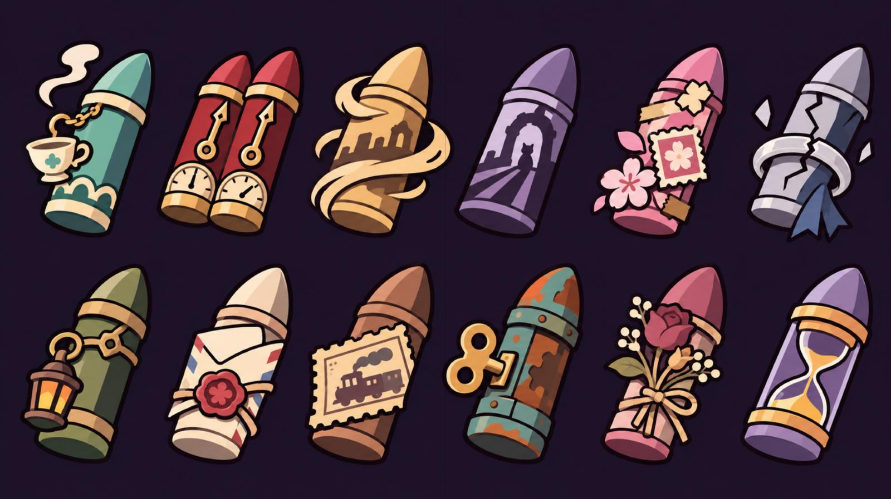

|  | Id | 이름 | 자리 조건 | 특성 | 슬롯 | 공격력 | 고유 효과 |
|---|---|---|---|---|---|---|---|
| 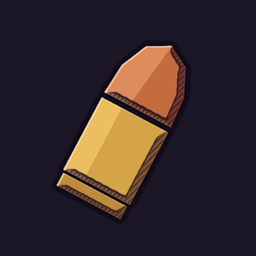 | 1000 | **탄환** | 없음 (기본 탄) | - | 0 | 8 |  |
| 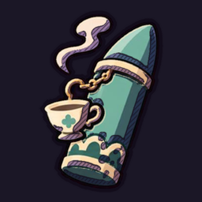 | 1001 | **티 타임** | 홀수 | 회상 · 종말 | 2 | 10 | [명중] 맞은 적을 살짝 밀쳐냄 |
|  | 1002 | **쌍둥이 초침** | 짝수 | 회상 · 지연 | 1 | 10 | [발사] 옆으로 1발 더 (피해 30%) |
|  | 1003 | **모래바람** | 3의 배수 | 망각 · 영원 | 2 | 10 | [명중] 1번 튕김 |
| 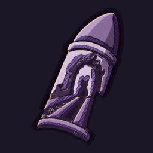 | 1004 | **짙어진 그림자** | 4의 배수 | 지연 · 영원 | 1 | 11 | [명중] 둔화 20%, 1.5초 |
|  | 1005 | **추억미화** | 소수 | 종말 · 추억 | 2 | 10 | [명중] 맞은 적 방어력 -10%, 3초 |
| 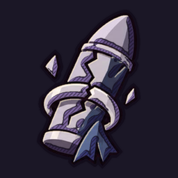 | 1006 | **부서진 맹세** | 8 미만 | 회상 · 되감기 | 0 | 12 | [명중] 맞으면 조각 2개로 갈라짐 (피해 40%) |
| 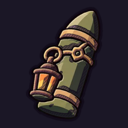 | 1007 | **꺼져 가는 등불** | 6 초과 | 지연 · 종말 | 2 | 10 | [명중] 3초 동안 초당 피해 5% |
|  | 1008 | **DEAR[ ]** | 3시 | 추억 · 미련 | 2 | 10 | [발사] 다음 탄 피해 +20% |
|  | 1009 | **노스탤지어** | 6의 배수 | 되감기 · 예지 | 1 | 11 | [명중] 1명 관통 |
| 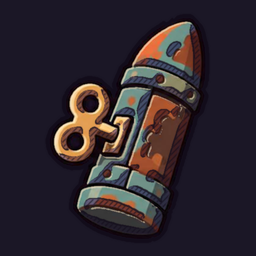 | 1010 | **녹슨 태엽** | 홀수 | 미련 · 망각 | 2 | 10 | [장전] 장전할 때 깨어나 있으면 열기 +0.1칸 |
|  | 1011 | **드라이드 플라워** | 짝수 | 예지 · 추억 | 1 | 10 | [처치] 처치하면 꽃잎 폭발 (피해 50%, 반경 2) |
|  | 1012 | **모래시계** | 음수 | 영원 · 미련 | 2 | 11 | [명중] 적 공격 속도 -20%, 2초 |
|  | 1037 | **회중시계의 눈금** | 2의 배수 | 예지 · 종말 | 1 | 10 | [상시] 치명타 확률 +6% |
| 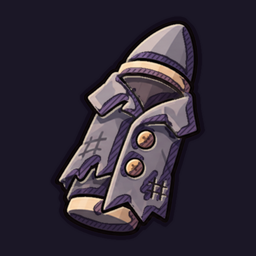 | 1038 | **낡은 회색 코트** | 홀수 | 영원 · 되감기 | 2 | 10 | [상시] 방어력 +6 |
| 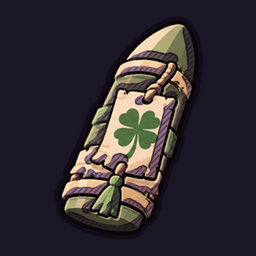 | 1039 | **네잎클로버 책갈피** | 소수 | 추억 · 예지 | 1 | 10 | [상시] 효과 발동 확률 +10% |

### 희귀

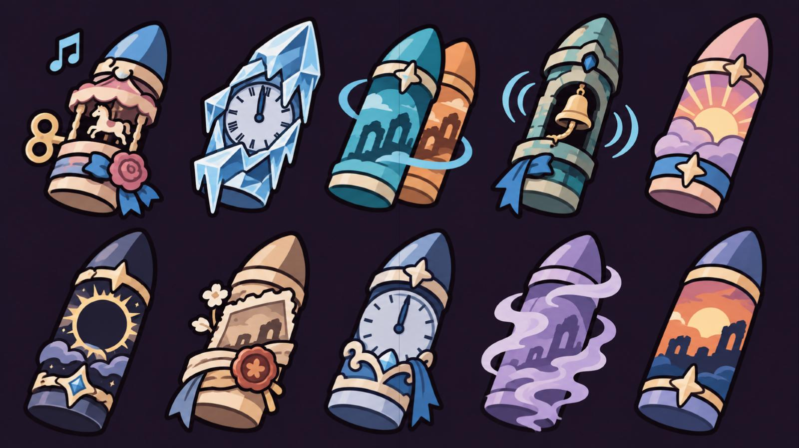

|  | Id | 이름 | 자리 조건 | 특성 | 슬롯 | 공격력 | 고유 효과 |
|---|---|---|---|---|---|---|---|
|  | 1013 | **시계태엽 오르골** | 짝수 | 예지 · 회상 | 2 | 12 | [발사] 다음 탄 연사 속도 +30% |
| 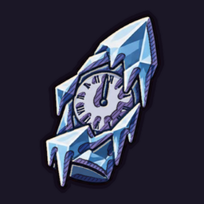 | 1014 | **얼어붙은 시간** | 12 초과 | 영원 · 망각 | 1 | 12 | [명중] 25% 확률로 0.5초 시간에 가둠 |
|  | 1015 | **평행세계** | 음수 | 되감기 · 지연 | 1 | 12 | [명중] 판정 시각 절댓값만큼 튕김 (최대 6) |
| 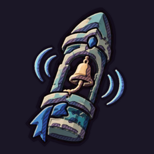 | 1016 | **종탑의 메아리** | 6의 배수 | 종말 · 예지 | 2 | 12 | [발사] 쏠 때 종소리, 반경 3 적 0.5초 경직 |
|  | 1017 | **새벽여명** | 1시 | 추억 · 회상 | 0 | 13 | [상시] 가장 가까운 적을 따라감 |
| 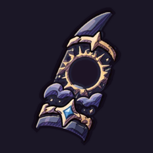 | 1018 | **개기일식** | 0시 | 지연 · 종말 | 2 | 12 | [명중] 큰 폭발 (피해 150%, 반경 3) |
|  | 1019 | **빛바랜 사진** | 소수 | 추억 · 미련 | 1 | 12 | [명중] 추억 표식이 있는 적에게 피해 +25% |
| 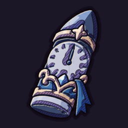 | 1020 | **고독** | 4의 배수 | 망각 · 영원 | 2 | 12 | [명중] 둔화된 적을 30% 확률로 1초 시간에 가둠 |
|  | 1021 | **아지랑이** | 홀수 | 되감기 · 예지 | 1 | 12 | [발사] 쏜 뒤 2초 동안 회피 +10% |
|  | 1022 | **황혼** | 4 미만 | 종말 · 미련 | 2 | 13 | [처치] 처치하면 열기 +0.25칸 |
|  | 1040 | **정오의 결투** | 6시 | 종말 · 회상 | 1 | 12 | [상시] 치명타 피해 +30% |
|  | 1041 | **철길 위의 동전** | 짝수 | 지연 · 종말 | 2 | 12 | [상시] 보스에게 주는 피해 +25% |
|  | 1042 | **바람개비** | 3 초과 | 되감기 · 회상 | 1 | 12 | [상시] 이동 속도 +10% |

### 영웅

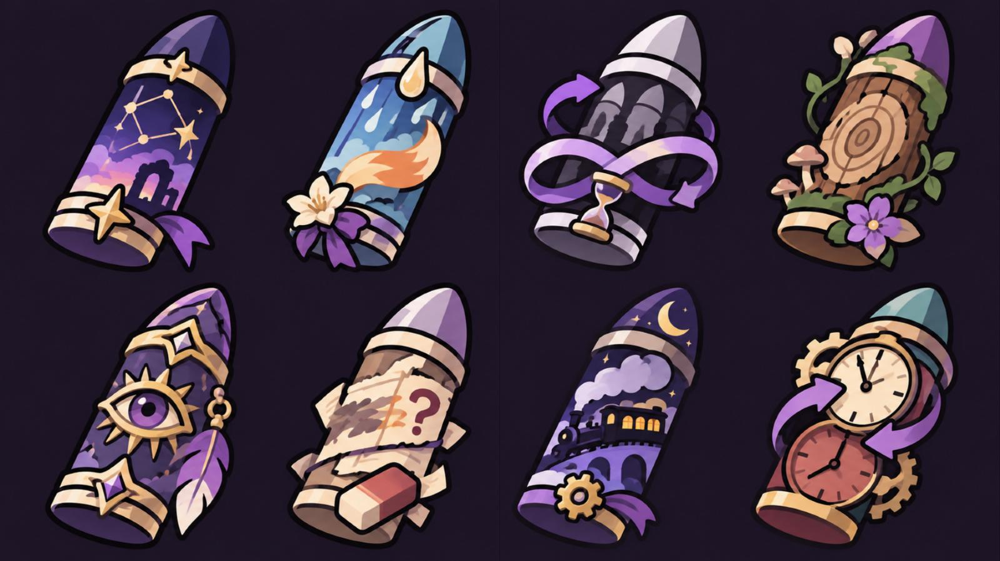

|  | Id | 이름 | 자리 조건 | 특성 | 슬롯 | 공격력 | 고유 효과 |
|---|---|---|---|---|---|---|---|
|  | 1023 | **천문박명** | 12시 | 종말 · 예지 | 1 | 15 | [상시] 12시 칸에 있으면 치명타 확정 / [명중] 보스에게 피해 +30% |
| 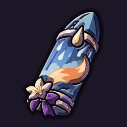 | 1024 | **여우비** | 소수 | 영원 · 지연 | 1 | 14 | [명중] 맞은 자리에 탄 궤적이 남고, 1.5초 뒤 실루엣이 그 궤적으로 1발 더 (피해 100%) |
|  | 1025 | **타임 루프 엔딩** | 홀수 | 회상 · 영원 | 2 | 14 | [발사] 35% 확률로 실루엣이 이 탄을 그대로 한 번 더 쏨 / [상시] 회상 특성을 1개 더 셈 |
|  | 1026 | **세월** | 4의 배수 | 종말 · 추억 | 0 | 15 | [명중] 2명 관통 / [관통] 관통할 때마다 피해 +25% |
|  | 1027 | **오딘의 눈동자** | 짝수 | 추억 · 미련 | 2 | 14 | [상시] 양옆 칸 탄의 판정 시각 +1 |
|  | 1028 | **건망증** | 음수 | 되감기 · 망각 | 1 | 14 | [발사] 25% 확률로 이 탄을 소모하지 않음 / [저스트 회피] 저스트 회피하면 즉시 장전 |
|  | 1029 | **야행열차** | 18 초과 | 지연 · 회상 | 0 | 16 | [명중] 2초 뒤 피해 100% 한 번 더 / [처치] 지연 피해로 처치하면 기적 소리와 함께 폭발 (피해 80%, 반경 3) |
|  | 1030 | **타임 패러독스** | 0시 | 영원 · 예지 | 1 | 14 | [상시] 실린더의 모든 탄 정지 · 둔화 지속 +50% / [장전] 장전할 때 반경 4 시간 감속 50%, 2초 |
| 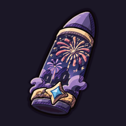 | 1043 | **불꽃놀이 마지막 발** | 3의 배수 | 지연 · 추억 | 1 | 14 | [상시] 폭발 · 범위 피해 +35% / [처치] 처치하면 그 자리에 폭죽처럼 폭발 (피해 60%, 반경 2.5) |
| 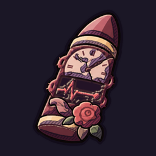 | 1044 | **멈춘 맥박** | 6 미만 | 망각 · 종말 | 2 | 14 | [상시] 정지 · 둔화 · 가둠 · 화상 · 표식이 있는 적에게 피해 +30% |

### 전설

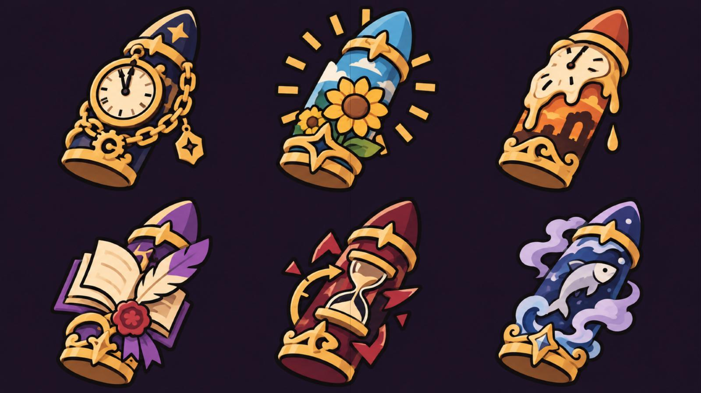

|  | Id | 이름 | 자리 조건 | 특성 | 슬롯 | 공격력 | 고유 효과 |
|---|---|---|---|---|---|---|---|
|  | 1031 | **열한 시 오십구 분** | 11시 | 망각 · 영원 | 0 | 18 | [발사] 쏘면 1초 동안 모든 적의 시간이 멈춤 (재사용 대기 20초) / [상시] 정지된 적에게 피해 +50% |
|  | 1032 | **그해 여름** | 1시 | 회상 · 추억 | 0 | 17 | [장전] 장전할 때 시계의 12방향으로 1발씩 사방 발사, 각 방향은 그 시각 칸의 탄으로 (피해 50%) / [상시] 회상 특성을 1개 더 셈 |
| 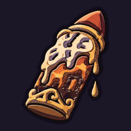 | 1033 | **여름의 지속** | 음수 | 지연 · 영원 | 1 | 16 | [상시] 판정 시각이 0보다 1 낮을 때마다 피해 +10% / [명중] 둔화 40%, 2초 |
|  | 1034 | **마지막 페이지** | 12시 | 종말 · 미련 | 2 | 18 | [명중] 맞히면 열기 1칸 / [상시] 12시 칸에 있으면 깨어나지 못한 탄 1개당 피해 +15% |
|  | 1035 | **변혁의 총탄** | 소수 | 되감기 · 지연 | 1 | 16 | [장전] 깨어나 있으면 다음 장전은 12 → 1 역순으로 발사 / [확률 회피] 확률 회피 성공 시 50% 확률로 현재 칸 탄 재장전 |
|  | 1036 | **레테의 물결** | 홀수 | 망각 · 예지 | 2 | 16 | [처치] 시간에 갇힌 적을 처치하면 런 동안 이 탄 공격력 +1 (최대 30) / [명중] 12% 확률로 1초 시간에 가둠 |
|  | 1045 | **운명의 동전 던지기** | 7시 | 예지 · 종말 | 1 | 17 | [상시] 치명타 확률 +12% / [상시] 치명타 피해 +50% |
|  | 1046 | **녹슬지 않는 갑주** | 음수 | 영원 · 되감기 | 2 | 16 | [상시] 방어력 +15 / [저스트 회피] 저스트 회피하면 열기 +0.5칸 |

## 7. 연산 (10종) [확정 범위 · 가중치는 1차안]

| Id | 연산 | 드랍 가중치 |
|---|---|---|
| 5001 | +1 | 100 |
| 5002 | +2 | 60 |
| 5003 | +3 | 30 |
| 5004 | -1 | 100 |
| 5005 | -2 | 60 |
| 5006 | -3 | 30 |
| 5007 | ×2 | 60 |
| 5008 | ×3 | 30 |
| 5009 | ÷2 | 60 |
| 5010 | ÷3 | 30 |

## 8. 데이터 테이블

### Bullet

| 열 | 타입 |
|---|---|
| Id | int |
| Name | string |
| Grade | enum |
| Damage | int |
| CondType | enum |
| CondValue | int |
| Trait1 | int |
| Trait2 | int |
| OpSlots | int |
| Effect1 | int |
| Effect2 | int |
| IconKey | string |
| Desc | string |

### Trait

| 열 | 타입 |
|---|---|
| Id | int |
| Name | string |
| Desc | string |
| IconKey | string |

### TraitTier

| 열 | 타입 |
|---|---|
| Id | int |
| TraitId | int |
| Tier | int |
| EffectId | int |

### Effect

| 열 | 타입 |
|---|---|
| Id | int |
| Trigger | enum |
| Cond | enum |
| CondValue | int |
| Chance | float |
| Target | enum |
| Type | enum |
| Value | float |
| Value2 | float |
| Duration | float |
| Desc | string |

### Op

| 열 | 타입 |
|---|---|
| Id | int |
| Name | string |
| OpType | enum |
| Operand | int |
| DropWeight | int |

## 9. 정해야 할 것
- [ ] 수치 조정 (플레이 테스트)
- [ ] 아이콘 최종본
- [ ] 탄 드랍 위치 (보상 방 · 상점 · 보스)
